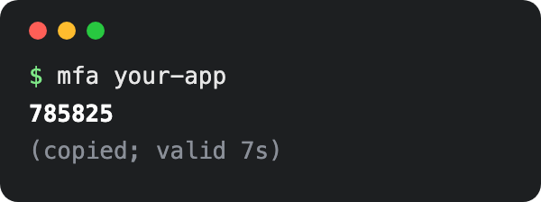

# mfa

<p align="center">
  
</p>

TOTP codes from the terminal, with seeds encrypted at rest using [age](https://age-encryption.org) and your SSH key.

```
mfa                        list entry names
mfa <name>                 print the current code (copied to clipboard on a tty)
mfa --add <name>           store a seed (base32 or otpauth:// URI), prompted hidden or from stdin
mfa --rm <name>            delete an entry
mfa --rekey                re-encrypt every entry to the current recipients
mfa --completion zsh|bash  print tab-completion setup for your shell rc
```

## Install

Requires `age`, `jq`, `oathtool`, and an SSH key at `~/.ssh/id_ed25519` or `~/.ssh/id_rsa`.

```sh
brew install age jq oath-toolkit     # macOS
sudo dnf install age jq oathtool     # Fedora
sudo apt install age jq oathtool     # Debian / Ubuntu
```

Then put `mfa` somewhere on your `PATH`:

```sh
mkdir -p ~/.local/bin
curl -fsSL https://raw.githubusercontent.com/nagstaku/mfa/main/mfa -o ~/.local/bin/mfa
chmod +x ~/.local/bin/mfa
echo 'eval "$(mfa --completion zsh)"' >> ~/.zshrc   # optional; use bash / ~/.bashrc for bash
```

## AI Agent Install

Paste this into Claude Code or any other coding agent:

```
Install mfa from https://github.com/nagstaku/mfa by following its README: install
age, jq and oathtool with my package manager, download the mfa script to
~/.local/bin/mfa and make it executable, make sure ~/.local/bin is on my PATH, and
add mfa's tab completion for my shell to my shell rc. Check that I have an SSH key
at ~/.ssh/id_ed25519 or ~/.ssh/id_rsa, then run `mfa --help` to confirm it works.
Don't add any seeds; I'll do that myself with `mfa --add`.
```

## Compatibility

`mfa` is a bash script (`#!/usr/bin/env bash`, bash 3.2 or newer), so it runs the same whatever your interactive shell is. Tab completion is provided for zsh and bash.

Tested on:

- macOS 26 with the system bash 3.2 and Homebrew bash 5.3
- Fedora 44 with bash 5.3

Clipboard copy uses `pbcopy` on macOS, `wl-copy` on Wayland and `xclip` on X11. If none is available, the code is just printed.

## Storage

Seeds live in `~/.oath/config` (override with `MFA_CONFIG`), each encrypted to the SSH public keys listed in `~/.oath/recipients`, falling back to `$MFA_IDENTITY.pub`. They're decrypted with `MFA_IDENTITY`, which defaults to `~/.ssh/id_ed25519` and then `~/.ssh/id_rsa`. To share one config across machines, put each machine's public key in `~/.oath/recipients` and run `mfa --rekey`.

Seeds are only passed through pipes, never on the command line.
